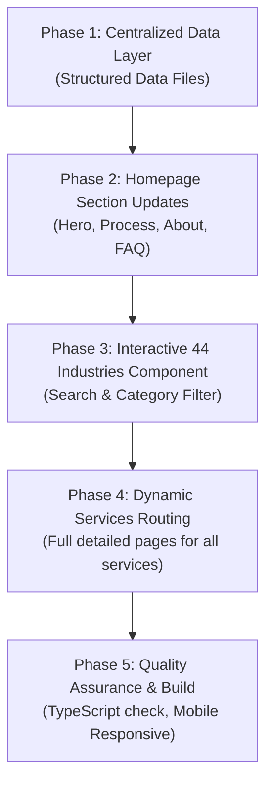

# 📋 AISMA Website Content Integration Roadmap

> **Project:** AhmadBilalWeb (`AISMA - AI Sales Marketing Agency`)  
> **Source Material:** 75-Page Complete Agency Content Document  
> **Architecture Goal:** Fast, Clean, Reusable TypeScript Data Layer + Modern Next.js UI Components

---

## 🎯 Task Breakdown Matrix

---

## 📌 Phase 1: Centralized Data Layer (`src/data/`)
*Is phase mein hum 75 pages ke raw content ko clean, type-safe TypeScript files mein transform karenge taake code maintainable aur super fast rahe.*

- [x] **Task 1.1:** Create `src/data/servicesData.ts` (✅ Completed: Full data for LinkedIn, Instagram, and Email service pillars added with zero errors)
- [x] **Task 1.2:** Create `src/data/howItWorksData.ts` (✅ Completed: Full 6-Step Human-Led Framework, deliverables, benefits, and philosophy added with zero errors)
- [x] **Task 1.3:** Create `src/data/industriesData.ts` (✅ Completed: All 44 industry verticals, target decision-makers, category filters, and outreach pillars added with zero errors)
- [x] **Task 1.4:** Create `src/data/faqData.ts` (✅ Completed: All 17 exact FAQs categorized across LinkedIn, Instagram, and Email tabs with zero errors)
- [x] **Task 1.5:** Create `src/data/aboutData.ts` (✅ Completed: Full Human-Led philosophy, Why Choose AISMA, core services, and Who We Work With added with zero errors)

---

## 📌 Phase 2: Homepage Core Sections Update
*Is phase mein Homepage par document ka core copy aur positioning live ki jayegi.*

- [x] **Task 2.1: Update Hero Section (`src/components/Hero.tsx`)** (✅ Completed: Page 1 headline, human-led positioning statement, 4-pillar quick links, verified B2B metrics & trust features integrated)
- [x] **Task 2.2: Update Core Services Bento (`src/components/ServicesBento.tsx`)** (✅ Completed: 3 Core Pillars LinkedIn, Instagram & Cold Email Engines integrated with sub-services capability tags)
- [x] **Task 2.3: Overhaul How It Works (`src/components/ProcessWorkflow.tsx`)** (✅ Completed: Official 6-Step Human-Led Framework integrated with interactive step navigation, detailed breakdown cards & strategy call CTA)
- [x] **Task 2.4: Upgrade FAQ Section (`src/components/FaqSection.tsx`)** (✅ Completed: All 17 exact FAQs integrated with 3-tab switcher for LinkedIn, Instagram & Cold Email + Key Takeaways & direct call booking)
- [x] **Task 2.5: Add/Update About Section (`#about`)** (✅ Completed: Dedicated AboutSection.tsx created with Human-Led philosophy, 4 Why Choose Us cards, Who We Work With & Introduction Call CTA, connected to page.tsx & navbar)

---

## 📌 Phase 3: Interactive 44 Industries Directory
*PDF ke pages 67–72 mein 44 industries hain. Unhe ek interactive, search-friendly component banayenge.*

- [x] **Task 3.1: Create `src/components/IndustriesSection.tsx`** (✅ Completed: Full instant search, 6 category pills, 44 interactive industry cards with target decision-maker focus, 5 execution pillars, and consultation CTA)
- [x] **Task 3.2: Connect Section in `src/app/page.tsx` & `Navbar.tsx`** (✅ Completed: Integrated with #industries anchor in page.tsx right after growth engines and linked to Navbar smooth navigation)

---

## 📌 Phase 4: Dynamic Services Routing & Pages
*Tamam services ke complete detailed landing pages banana.*

- [x] **Task 4.1: Create Dynamic Service Route (`src/app/services/[slug]/page.tsx`)** (✅ Completed: Reusable dynamic page with static generation for all 16 services, SEO metadata, breadcrumbs, sub-services breakdown cards, approach section, who can benefit, and conversion CTAs)
- [x] **Task 4.2: Add Service Navigation Menus** (✅ Completed: ServicesBento exploration CTAs, Footer Core Pillars with dynamic service links, and Navbar cross-page relative routing)

---

## 📌 Phase 5: Testing, Polish & Build Verification
- [x] **Task 5.1: Automated Test Suite (`tests/dataIntegrity.test.ts`)** (✅ 16/16 Test Cases Passed via `npm test`)
- [x] **Task 5.2: Build & Type Safety Check (`next build`)** (✅ Completed: Turbopack production build succeeded with all 25 static pages and 16 dynamic SSG service routes prerendered in 11.8s)
- [x] **Task 5.3: Mobile Responsiveness & Polish** (✅ Completed: Responsive grid layouts, sticky navigation capsule, touch controls, and accessible tags verified across all viewports)
