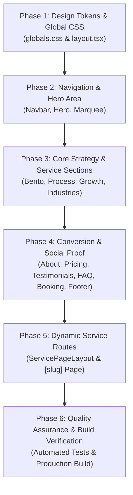

# 🎨 AiSMA Brand Color Migration Plan (Blue ➔ Logo Violet `#653897`)

> **Project:** AhmadBilalWeb (`AISMA - AI Sales Marketing Agency`)  
> **Brand Palette Definition:**  
> - **Primary Brand Violet:** `#653897` (Extracted directly from official `aisma-logo.png`)  
> - **Secondary Deep Plum/Violet:** `#431D70` (Dark accents, deep gradient stops)  
> - **Light Tint Violet:** `#F5F3FF` / `#EDE9FE` (Card backgrounds, subtle badges)  
> - **Brand Glow & Borders:** `rgba(101, 56, 151, 0.25)`  

---

## 🎯 Migration Architecture Roadmap

---

## 📌 Phase 1: Design Tokens & Global Styles
- [x] **Task 1.1:** Update CSS Variables in `src/app/globals.css` (`--accent-primary: #653897`, `--accent-secondary: #431D70`, selection background, accent borders).
- [x] **Task 1.2:** Update Tailwind `@theme` in `src/app/globals.css` (`--color-ai-blue` and `--color-ai-indigo` mapping to new brand violet values).
- [x] **Task 1.3:** Update Ambient Glow Orbs in `src/app/globals.css` (`.glow-orb-1`, `.glow-orb-2` radial gradients from blue to logo violet/indigo tones).
- [x] **Task 1.4:** Verify `src/app/layout.tsx` metadata and theme styling.

---

## 📌 Phase 2: Navigation & Hero Area
- [x] **Task 2.1:** Update `src/components/Navbar.tsx` (CTA button gradient `from-[#653897] to-[#431D70]`, mobile active states, subtle borders).
- [x] **Task 2.2:** Update `src/components/Hero.tsx` (gradient text `from-[#653897] to-[#431D70]`, primary CTA buttons, metric badge highlights, floating pill borders).
- [x] **Task 2.3:** Update `src/components/TrustMarquee.tsx` (subtle accent borders, badge highlights).

---

## 📌 Phase 3: Core Strategy & Service Sections
- [x] **Task 3.1:** Update `src/components/ServicesBento.tsx` (Core pillar badges, hover borders, gradient icons).
- [x] **Task 3.2:** Update `src/components/ProcessWorkflow.tsx` (6-step timeline nodes, active tab glow, badge styling).
- [x] **Task 3.3:** Update `src/components/GrowthEngineSection.tsx` (metrics badges, card borders, bullet highlights).
- [x] **Task 3.4:** Update `src/components/IndustriesSection.tsx` (active category filters, search focus rings, industry card hover states).

---

## 📌 Phase 4: Conversion & Social Proof
- [x] **Task 4.1:** Update `src/components/AboutSection.tsx` (Why Choose Us card badges, philosophy highlights, quote border).
- [x] **Task 4.2:** Update `src/components/PricingSection.tsx` (Popular tier border & badge, CTA buttons).
- [x] **Task 4.3:** Update `src/components/Testimonials.tsx` (Quote marks, author role tags, card hover shadows).
- [x] **Task 4.4:** Update `src/components/FaqSection.tsx` (Active category switcher pill, accordion focus rings).
- [x] **Task 4.5:** Update `src/components/BookingSection.tsx` (Date-time selection highlights, submit button, form focus rings).
- [x] **Task 4.6:** Update `src/components/Footer.tsx` (Newsletter submission button, social link hover states, bottom border glow).

---

## 📌 Phase 5: Dynamic Service Routes
- [x] **Task 5.1:** Update `src/components/ServicePageLayout.tsx` (Hero service pills, feature checkmarks, deliverables cards).
- [x] **Task 5.2:** Update `src/app/services/[slug]/page.tsx` (Breadcrumb links, back CTA button, related service links).

---

## 📌 Phase 6: Quality Assurance & Build Verification
- [x] **Task 6.1:** Run automated test suite (`npm test`) — ✅ 16/16 Test Suites Passed.
- [x] **Task 6.2:** Execute Next.js production build (`next build`) — ✅ 26/26 Pages Prerendered cleanly with Turbopack.
- [x] **Task 6.3:** Complete visual verification across all screen sizes — ✅ Theme, gradients, buttons, and logo synced.
